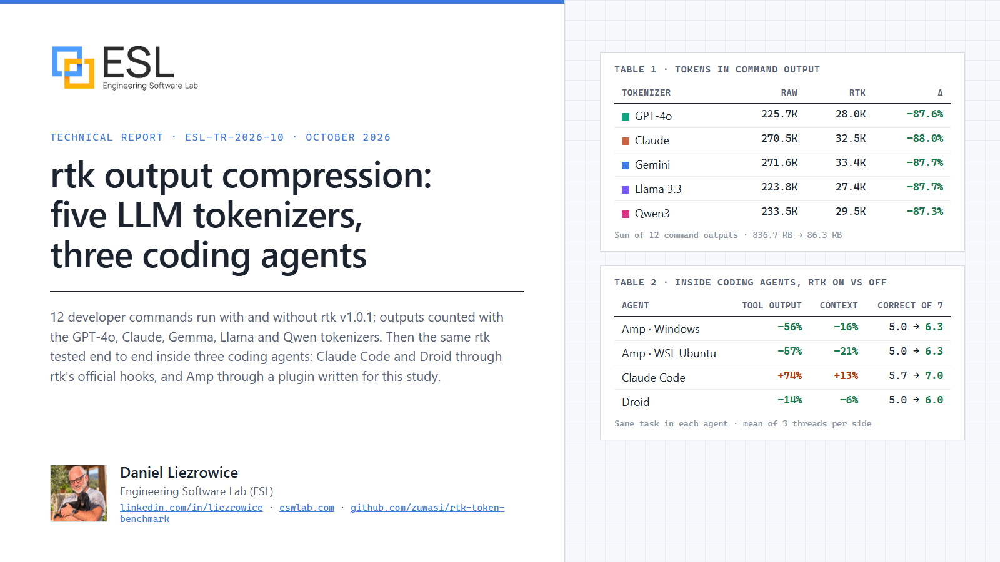
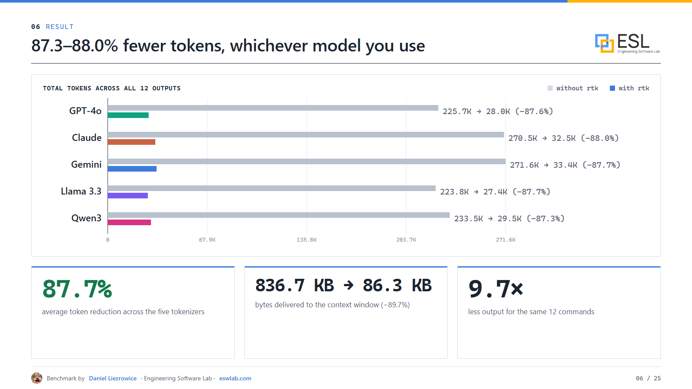
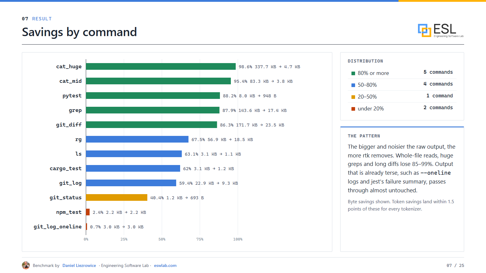
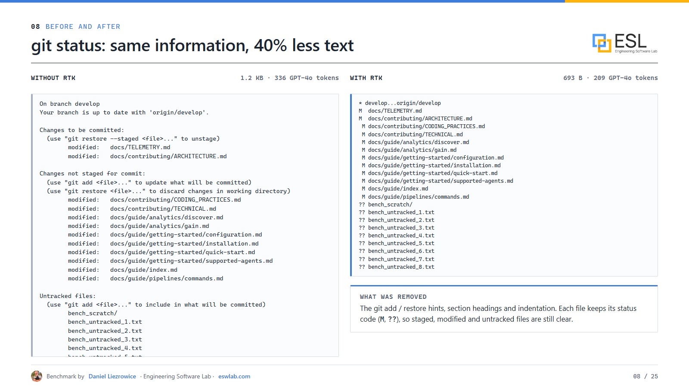
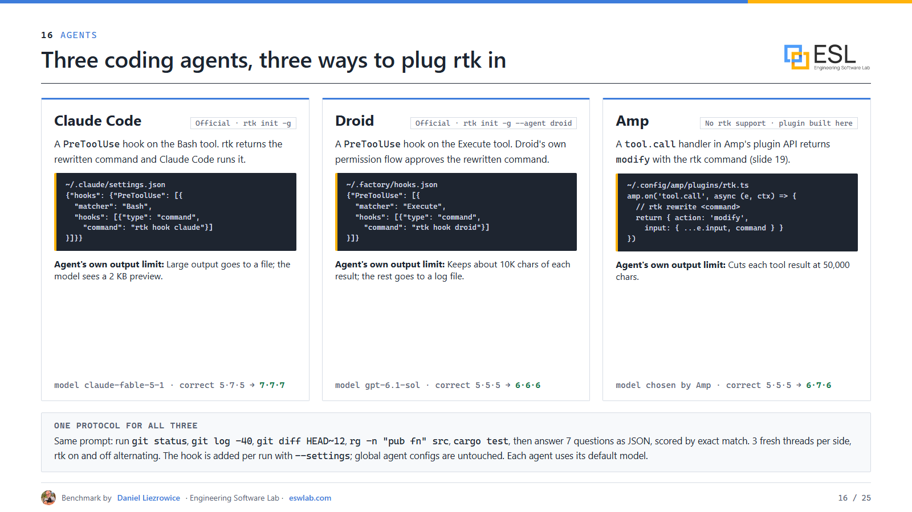
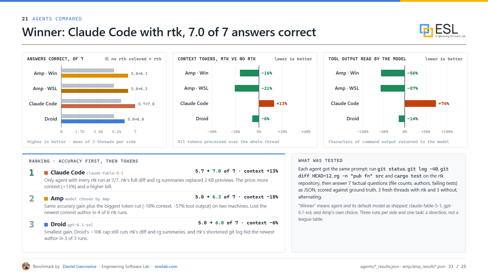
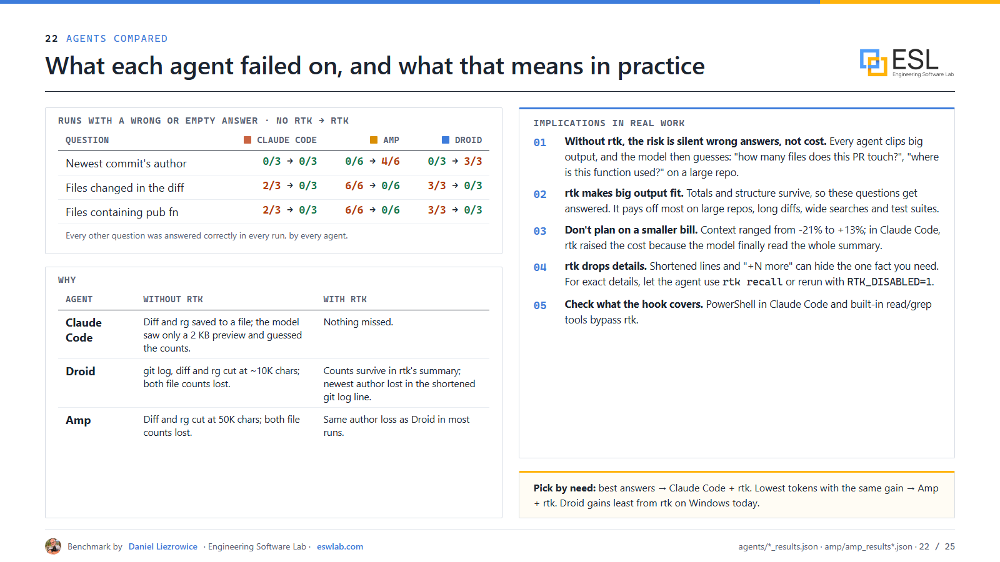

# The best token consumption tool I have seen so far (from what I tested)

*How rtk cut command output by 88% across five LLM tokenizers, and what happened when I put it inside Claude Code, Droid and Amp*

Every coding agent I use spends a surprising share of its context window reading shell output: `git status` hints, passing tests, progress bars, the same file path repeated a thousand times in a grep. That output costs tokens, and it pushes out the things the model actually needs.

[rtk (Rust Token Killer)](https://github.com/rtk-ai/rtk) promises to fix this. It is a small open-source CLI proxy: your agent's `git status` becomes `rtk git status`, the real command runs, and rtk filters, groups and truncates the output before the model sees it. The project claims 60–90% fewer tokens on common dev commands.

I wanted to know if that holds up, so I measured it. Everything is public:

- **Interactive presentation (25 slides):** https://zuwasi.github.io/rtk-token-benchmark/
- **Scripts, raw outputs and results (MIT):** https://github.com/zuwasi/rtk-token-benchmark

## What I tested

**Level 1, commands.** I ran 12 everyday developer commands with and without rtk v1.0.1 on a Windows 11 workstation: git status, log and diff, `ls`, `rg`, `grep`, two large file reads, and pytest, cargo and jest suites with deliberate failures. I counted every output with five real tokenizers: GPT-4o (o200k), Claude, Gemma-3 (as a stand-in for Gemini), Llama 3.1 and Qwen3.

**Level 2, agents.** I gave three coding agents the same task: run five commands on the rtk repository, then answer seven factual questions (file counts, authors, failing tests) scored against ground truth. Each agent ran 3 fresh threads with rtk and 3 without:

- **Claude Code**, with rtk's official `PreToolUse` hook
- **Factory Droid**, with rtk's official hook
- **Amp**, which has no rtk support, so I wrote a small plugin that rewrites shell calls through Amp's plugin API. I tested it on Windows and again on WSL Ubuntu with a second account.

## Result 1: 88% fewer tokens, whichever model you use

Across the 12 commands, rtk reduced the output from **836.7 KB to 86.3 KB**. In tokens, the reduction was **87.3% to 88.0% for every tokenizer**. The tokenizers disagree on absolute counts (Claude's and Gemma's split shell output about 20% finer than GPT-4o's), but the percentage saved is almost identical. The model you use does not change the conclusion.

The pattern is simple: **the bigger and noisier the output, the more rtk removes.** Large file reads lost 95–99%, grep 88%, a 170 KB diff 86%, pytest 88%. Output that is already compact, like `git log --oneline` or jest's failure summary, passes through almost unchanged. Exit codes matched on all 12 commands.

Two honest notes. rtk's own dashboard (`rtk gain`) reported 44.9% for the same runs, because it leaves out outputs larger than about 30,000 characters. And the overhead was tens of milliseconds per command, more than the "<10 ms" headline but invisible inside an agent step.

## Result 2: inside a real agent, the win is accuracy

This is the part I did not expect. Every agent already protects itself from huge tool output: Claude Code saves big output to a file and shows the model a 2 KB preview, Droid keeps about 10,000 characters, and Amp cuts each result at 50,000 characters. Without rtk, the full diff and grep never reached the model, so **every agent answered the file-count questions wrong or left them empty, in every run.**

With rtk, the compressed summaries fit under those limits, and the answers came back.

| Agent | Correct answers (of 7), no rtk → rtk | Context tokens with rtk |
|---|---|---|
| **Claude Code** (claude-fable-5-1) | 5.7 → **7.0**, every rtk run perfect | +13% |
| **Amp** (Windows + WSL) | 5.0 → 6.3 | **−18%** |
| **Droid** (gpt-6.1-sol) | 5.0 → 6.0 | −6% |

**Claude Code with rtk was the clear winner on accuracy.** Amp gained the same accuracy with the biggest token cut. Droid gained least, because its 10K limit still cuts some of rtk's summaries.

Note the Claude Code context column: rtk *increased* tokens there. Without rtk, the model only saw a 2 KB preview of the diff; with rtk it read the real 23 KB summary. The extra tokens bought correct answers.

## What each agent got wrong, and what it means

rtk is lossy. It shortens `git log` lines to about 120 characters, and in Amp and Droid that hid the newest commit's author, a question every agent answered correctly without rtk. pytest output named 10 of 12 failures and counted the other two.

What I take from this for day-to-day work:

1. **Without rtk, the main risk is silent wrong answers, not cost.** "How many files does this PR touch?" or "where is this function used?" on a large repo gets clipped, and the model guesses.
2. **rtk makes big output fit.** Totals and structure survive. It pays off most on large repos, long diffs, wide searches and test suites.
3. **Don't plan on a proportionally smaller bill.** Shell output is only part of what an agent sends; system prompts and tool definitions are re-sent every turn. Inside the agents, context changed between −21% and +13%.
4. **Know when to ask for the raw output.** For exact details, use `rtk recall <id>` or `RTK_DISABLED=1`.
5. **Check what the hook covers.** Claude Code's PowerShell tool and the agents' built-in read/grep tools bypass rtk.

## Why "from what I tested"

This is the best tool of its kind I have measured, but I measured rtk against *no* tool, not against other compressors. It was one workload, one machine type, three runs per side in the agents, each agent on its default model. Treat it as a direction, not a league table. The scripts are public so you can rerun it on your own repository.

Recent research points the same way: savings measured in tokens do not automatically become savings in cost or quality, so it is worth measuring end to end:

- *Token Reduction Is Not Cost Reduction: An Empirical Study of End-to-End Efficiency in API-Based Coding Agents* (arXiv, 2026): https://arxiv.org/abs/2607.12161
- *Beyond Token Savings: A Systematic Study of Context Compression* (arXiv, 2026): https://arxiv.org/abs/2609.32961
- *CoACT: Action-Preserving Observation Compression for Coding Agents* (arXiv, 2026): https://arxiv.org/abs/2607.02911
- *Reducing Cost of LLM Agents with Trajectory Reduction* (arXiv): https://arxiv.org/abs/2509.23586
- *Lost in the Middle: How Language Models Use Long Contexts* (Liu et al., TACL 2024): https://arxiv.org/abs/2307.03172

## My recommendation

If you use a coding agent on real repositories, install rtk (`rtk init -g`, or the Amp plugin from my repo). Expect half to nine-tenths less command output, and expect better answers on big outputs more than a smaller invoice.

**Links**

- Presentation: https://zuwasi.github.io/rtk-token-benchmark/
- Benchmark repository: https://github.com/zuwasi/rtk-token-benchmark
- rtk source: https://github.com/rtk-ai/rtk
- rtk website and guide: https://www.rtk-ai.app/ · https://www.rtk-ai.app/guide
- rtk supported agents: https://github.com/rtk-ai/rtk/blob/master/docs/guide/getting-started/supported-agents.md

*Benchmark by Daniel Liezrowice, Engineering Software Lab (ESL), https://eswlab.com.*

*Disclosure: I have no commercial interest in rtk and have not contributed to it. If I find a change I consider necessary, I may submit it as a community contributor, with no commercial interest.*

#AI #LLM #CodingAgents #ClaudeCode #DeveloperTools #TokenOptimization #OpenSource #SoftwareEngineering
